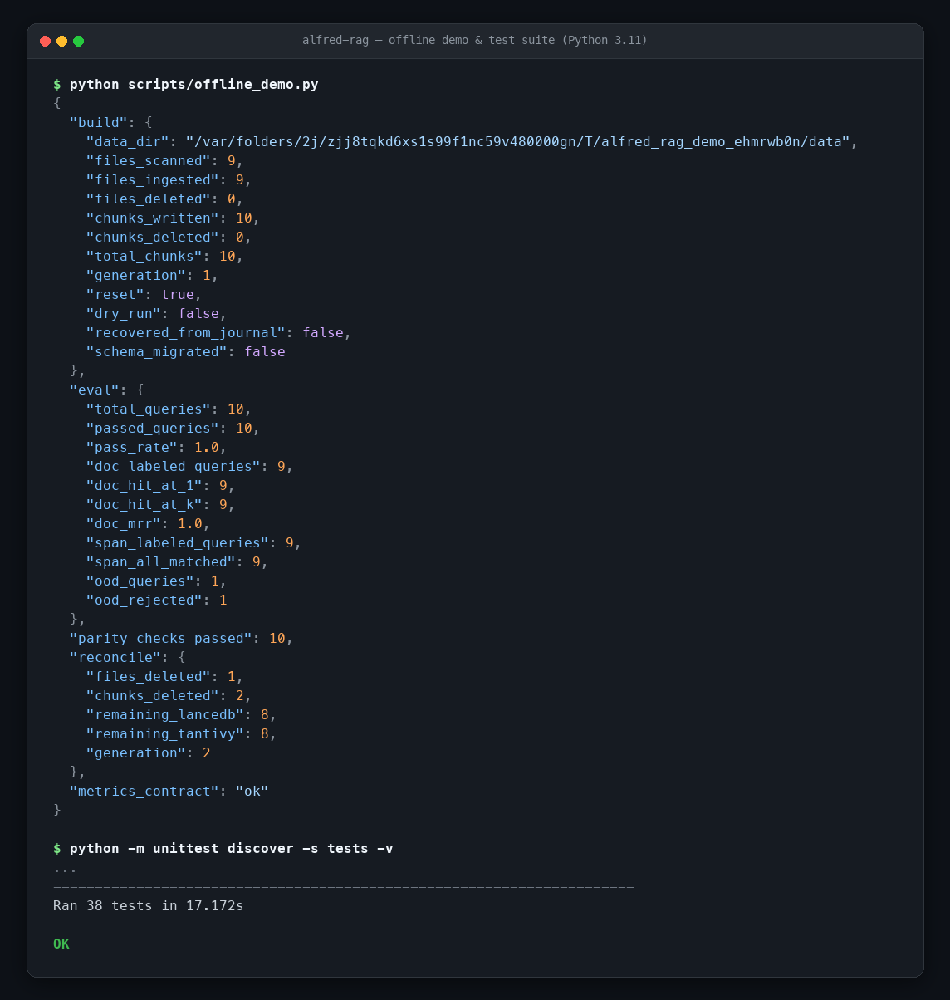

# alfred-rag

A hybrid retrieval and reranking service combining dense vector search ([LanceDB](https://lancedb.com/)), sparse BM25 full-text search ([Tantivy](https://github.com/quickwit-oss/tantivy)), Reciprocal Rank Fusion (RRF), and cross-encoder reranking (`Qwen3-Reranker-8B`), plus a deterministic CPU-only offline mode and a `sentence-transformers` fine-tuning recipe.



## Problem

Running hybrid retrieval in production over a living document corpus fails in predictable ways that neither a vector store nor a full-text engine solves on its own:

- **Dual-store drift**: deleting or emptying source documents, resetting an empty corpus, or crashing mid-ingest leaves LanceDB and Tantivy out of sync and serves deleted passages as if they still existed.
- **Eval-vs-serving divergence**: benchmarking a separate debug endpoint that omits query instructions, candidate caps, domain boosts, recency weighting, or source diversification produces scores that do not reflect `/search`.
- **Identity collapse**: hashing chunks from upstream `source` labels or diversifying on bare filenames collapses distinct documents (`operations/notes.md` vs `engineering/notes.md`) and double-counts repeated IDs in RRF.
- **Unsafe defaults**: binding unauthenticated corpus reads and destructive index resets to `0.0.0.0` exposes private corpora by default.

## What `alfred-rag` Contributes on Top of LanceDB & Tantivy

LanceDB and Tantivy provide the underlying vector and BM25 primitives; `alfred-rag` provides the coordination, retrieval policy, evaluation parity, and operational guardrails around them:

- **Generation-tracked dual-store ingestion (`scripts/ingest.py`)**: reconciles added, edited, emptied, and deleted files across both LanceDB and Tantivy; validates embedding cardinality and vector dimensions before mutating either store; automatically detects and stages safe full-rebuild migrations for legacy v1 schemas (missing `doc_id`/`source_class` or legacy Tantivy tokenizers); verifies committed row counts before clearing `.ingest_journal.json`; and fails `/health`, `/ready`, `/search`, and `/search/debug` closed (HTTP 503) whenever a journal is pending or store generations/counts disagree so mixed generations are never served.
- **Single-pipeline serving & evaluation (`rag_server.py`, `rag_eval.py`)**: `/search` and `/search/debug` execute the exact same `_execute_search` function, guaranteeing identical IDs, ordering, and scores between production traffic and evaluation diagnostics.
- **Canonical document identity & source classification (`rag_common.py`)**: separates stable corpus-relative `doc_id` from display `source`/`url` fields, persists explicit `source_class` (`curated` vs `vendor`) in both stores, deduplicates each RRF leg, and breaks real fast-path RRF score ties using document recency.
- **Loopback-by-default security & bounded requests**: defaults to `127.0.0.1`, refuses non-loopback binds unless both `ALLOW_EXTERNAL_BIND=1` and `RAG_API_KEY` are set, separates full resets onto `POST /admin/ingest/reset` (`RAG_ADMIN_API_KEY`), and enforces body-size and parameter limits.
- **Zero-GPU verification path**: ships a public synthetic corpus (`fixtures/demo_corpus/`), labeled queries with exact document IDs, quoted source spans, and out-of-domain negative controls (`fixtures/demo_eval_queries.json`), and a deterministic CPU offline demo (`scripts/offline_demo.py`).

## Architecture

```
                         +----------------------------------+
   Source Corpus         |  scripts/ingest.py               |
   (.md/.txt/.json/      |  - SHA-256 change + delete diff  |
    .jsonl/.rst)   ----> |  - canonical doc_id + source_class|
                         |  - .ingest_journal.json + staging|
                         +---------+---------------+--------+
                                   |               |
                         .generation.json     .generation.json
                                   v               v
                            +-----------+    +-----------+
                            |  LanceDB  |    |  Tantivy  |
                            |  (Dense)  |    |  (BM25)   |
                            +-----+-----+    +-----+-----+
                                  |                |
   Client / Eval                  +-------+--------+
   (127.0.0.1 default,                    |
    optional RAG_API_KEY)                 v
   POST /search           +-------------------------------+
   POST /search/debug --> |  _execute_search() (unified)  |
                          |  1. Instructed query embed    |
                          |  2. Dense + BM25 search       |
                          |  3. Deduplicated RRF (k=60)   |
                          |  4. Rerank (or fast RRF path) |
                          |  5. Domain boost + recency +  |
                          |     vendor class + doc_id cap |
                          +---------------+---------------+
                                          |
                                          v
                           Identical final top_k results
                           (+ stage diagnostics on /debug)
```

## Components

| File | Purpose |
|---|---|
| `rag_common.py` | Shared Tantivy schema, LanceDB helpers, device & bind-safety resolvers, generation/journal I/O, deterministic offline hash embedder & lexical reranker |
| `rag_server.py` | FastAPI server: `/search`, `/search/debug`, `/embed`, `/rerank`, `/ingest`, `/admin/ingest/reset`, `/health`, `/ready`, `/metrics` |
| `scripts/ingest.py` | Dual-store corpus builder: incremental add/edit/empty/delete reconciliation, staged `--reset`, journal crash recovery, `hf` or `offline` embedding backend |
| `rag_eval.py` | Eval harness scoring exact `doc_id` Hit@1/Hit@k/MRR, quoted source spans, out-of-domain rejection, per-stage dropout, and run provenance |
| `scripts/offline_demo.py` | 5-minute (runs in ~2s) CPU-only end-to-end demo exercising real LanceDB + Tantivy indexes, eval parity, deletion recovery, and metrics |
| `fixtures/demo_corpus/` | Synthetic multi-domain public corpus (9 files, 10 chunks) with vendor docs, same-basename files, shared-source JSONL, and dated docs |
| `fixtures/demo_eval_queries.json` | 10 labeled evaluation queries (exact `doc_id`, quoted spans, keywords, and an out-of-domain negative control) |
| `finetune_embedding.py` | Fine-tune `Qwen3-Embedding-8B` (or any `sentence-transformers` base) on `(query, positive)` pairs with `MultipleNegativesRankingLoss` |

## 5-Minute Offline Demo (CPU-Only, No GPU / No Private Data)

**Requires Python >= 3.11.**

### 1. Create a virtual environment and install lightweight CPU dependencies

```bash
python3.11 -m venv .venv && source .venv/bin/activate
python -m pip install -r requirements-offline.txt
# Equivalent explicit package list:
# python -m pip install fastapi uvicorn pydantic lancedb tantivy prometheus-client requests httpx
```

*(For full GPU serving and fine-tuning with Qwen3-8B models, install `pip install -r requirements.txt`.)*

### 2. Run the offline demo

```bash
python scripts/offline_demo.py
```

This builds real LanceDB and Tantivy indexes from `fixtures/demo_corpus/`, checks `/health` and `/ready`, runs all 10 labeled queries through both `/search` and `/search/debug` (verifying exact ID and score parity), deletes one document and empties another to verify dual-store reconciliation, and checks `/metrics`.

Expected output:

```json
{
  "build": {
    "files_scanned": 9,
    "files_ingested": 9,
    "files_deleted": 0,
    "chunks_written": 10,
    "chunks_deleted": 0,
    "total_chunks": 10,
    "generation": 1,
    "reset": true,
    "dry_run": false,
    "recovered_from_journal": false,
    "schema_migrated": false
  },
  "eval": {
    "total_queries": 10,
    "passed_queries": 10,
    "pass_rate": 1.0,
    "doc_labeled_queries": 9,
    "doc_hit_at_1": 9,
    "doc_hit_at_k": 9,
    "doc_mrr": 1.0,
    "span_labeled_queries": 9,
    "span_all_matched": 9,
    "ood_queries": 1,
    "ood_rejected": 1
  },
  "parity_checks_passed": 10,
  "reconcile": {
    "files_deleted": 1,
    "chunks_deleted": 2,
    "remaining_lancedb": 8,
    "remaining_tantivy": 8,
    "generation": 2
  },
  "metrics_contract": "ok"
}
```

### 3. Run the full regression and deletion-recovery test suite

```bash
python -m unittest discover -s tests -v
```

This runs unit tests plus real CPU LanceDB + Tantivy integration tests covering:
- Incremental deletion and emptying across both stores
- Empty `--reset` agreement across both stores (LanceDB table dropped + Tantivy 0 docs + HTTP 503 readiness)
- Simulated crash mid-ingest (`.ingest_journal.json` fails `/health`, `/ready`, `/search`, and `/search/debug` with 503 so mixed generations are never served, then next `ingest()` replays cleanly with zero duplicates)
- Atomic dual-store reader reopen (snapshots pre-open and post-open committed marker state across LanceDB and Tantivy opens, discards torn handles and retries boundedly on equal-count mid-open commits, and fails closed with HTTP 503 if an active writer prevents establishing a consistent generation pair)
- Short or dimension-mismatched embedding batches (rejected before mutating either store, preserving `.ingest_journal.json` without partial commits)
- Legacy v1 schema migration (indexes missing `doc_id`/`source_class` or `raw` Tantivy tokenizers are detected at preflight and safely migrated via staged rebuild on incremental ingest without requiring manual `--reset`)
- `/search` vs `/search/debug` identity across `rerank=True` and `rerank=False`
- Same-basename diversification (`max_per_source=1`), shared-upstream-source JSONL isolation, and per-leg RRF deduplication
- Explicit `source_class=vendor` deprioritization and real fast-path RRF tie-breaking by recency
- Loopback bind safety, API-key & admin-reset authorization, and request body/parameter bounds
- Prometheus metric naming and scored-document accounting

## Measured Results

Verified in a clean, isolated Python 3.11 virtual environment (`requirements-offline.txt`, CPU-only `RAG_BACKEND=offline`) against the public synthetic fixture corpus (`fixtures/demo_corpus/`, 9 files / 10 chunks) and labeled query set (`fixtures/demo_eval_queries.json`, 10 queries):

| Check | Measured Result |
|---|---|
| `python scripts/offline_demo.py` wall time | `5.272s` (exit code `0`) |
| Labeled query pass rate | `10/10` (`100%`, `pass_rate: 1.0`) |
| Exact document recall & ranking (9 in-domain queries) | `Hit@1: 9/9`, `Hit@k: 9/9`, `MRR: 1.0` |
| Verbatim quoted span check | `9/9` matched (`span_all_matched: 9/9`) |
| Out-of-domain negative control | `1/1` rejected (`ood_rejected: 1/1`) |
| `/search` vs `/search/debug` rank & score parity | `10/10` (`parity_checks_passed: 10`) |
| Deletion & emptying reconciliation | `1` file deleted + `1` file emptied → `2` chunks purged; `8` LanceDB / `8` Tantivy remaining (`generation=2`) |
| Prometheus `/metrics` contract | `ok` |
| `python -m unittest discover -s tests -v` | `38/38` tests passed (`OK` in `17.172s`, wall time `18.043s`) |

## Serving with GPU Models (`Qwen3-Embedding-8B` + `Qwen3-Reranker-8B`)

Full GPU serving with both 8B models in fp16 requires a CUDA GPU (or unified-memory accelerator) with roughly 32 GB+ VRAM. For CPU-only testing, use `RAG_BACKEND=offline` as shown below.

### 1. Index a corpus

Place documents under `./data/<domain>/` (`.md`, `.txt`, `.rst`, `.json`, or `.jsonl`). Bulk reference documents placed under `./data/docs/` or `./data/vendor/` automatically receive `source_class=vendor`:

```bash
# GPU / HuggingFace embeddings
DEVICE=cuda python scripts/ingest.py --data-dir ./data --reset

# Or CPU-only offline demo backend against the synthetic fixture corpus
python scripts/ingest.py --data-dir ./fixtures/demo_corpus --embed-backend offline --reset
```

### 2. Start the server (loopback by default)

```bash
# Loopback-only local server (default HOST=127.0.0.1, PORT=9000)
export DEVICE=cuda          # auto | cuda | mps | cpu
export PORT=9000
python rag_server.py

# Or start with the CPU offline backend
RAG_BACKEND=offline PORT=9000 python rag_server.py
```

To expose the server beyond loopback, you must explicitly opt in AND set an API key (plus an optional dedicated admin key for resets):

```bash
export HOST=0.0.0.0
export PORT=9000
export ALLOW_EXTERNAL_BIND=1
export RAG_API_KEY="replace-with-strong-secret"
export RAG_ADMIN_API_KEY="replace-with-admin-secret"
python rag_server.py
```

### 3. Query and evaluate

```bash
curl -s http://127.0.0.1:9000/search \
  -H "Content-Type: application/json" \
  -d '{"query": "How does Reciprocal Rank Fusion merge dense and BM25 rankings?", "top_k": 5}' | jq .

python rag_eval.py \
  --server http://127.0.0.1:9000 \
  --queries fixtures/demo_eval_queries.json \
  --output-dir eval_results
```

`rag_eval.py` writes per-query stage JSON files, `eval_summary.csv`, and `eval_report.json` (including git commit, query file SHA-256, active models, index generation, Hit@1, Hit@k, MRR, span recall, and out-of-domain rejection rate).

## Fine-Tuning

If a base embedding model misses domain vocabulary, fine-tune it on `(query, positive)` pairs:

```bash
# training_data/embedding_pairs.jsonl format:
# {"query": "...", "positive": "..."}
python finetune_embedding.py \
  --base-model Qwen/Qwen3-Embedding-8B \
  --data-path ./training_data/embedding_pairs.jsonl \
  --output-dir ./models/qwen3-embedding-8b-ft \
  --epochs 3 --batch-size 4 --lr 3e-5
```

Uses `MultipleNegativesRankingLoss` (in-batch negatives) and holds out `--eval-split` (default `0.1`) for `InformationRetrievalEvaluator`.

## Configuration

| Variable | Default | Notes |
|---|---|---|
| `HOST` | `127.0.0.1` | Loopback default; non-loopback requires `ALLOW_EXTERNAL_BIND=1` and `RAG_API_KEY` |
| `PORT` | `9000` | Server HTTP port |
| `ALLOW_EXTERNAL_BIND` | `0` | Set to `1` to allow binding non-loopback interfaces (with `RAG_API_KEY`) |
| `RAG_API_KEY` | *(unset)* | Protects `/search`, `/search/debug`, `/embed`, `/rerank`, `/ingest`, `/metrics` via `Authorization: Bearer` or `X-API-Key` |
| `RAG_ADMIN_API_KEY` | *(unset)* | Protects `/admin/ingest/reset` and `/ingest` with `reset=true` |
| `RAG_BACKEND` | `hf` | `hf` (Qwen3 HuggingFace models) or `offline` (deterministic CPU demo backend) |
| `DEVICE` | `auto` | Shared across `rag_server.py` and `scripts/ingest.py`: `auto`, `cuda`, `mps`, or `cpu` |
| `EMBED_MODEL_PATH` | `Qwen/Qwen3-Embedding-8B` | HuggingFace model ID or local path |
| `EMBED_MODEL_REVISION` | `1d8ad4ca9b3dd8059ad90a75d4983776a23d44af` | Pinned Hub revision |
| `RERANKER_MODEL_PATH` | `Qwen/Qwen3-Reranker-8B` | HuggingFace model ID or local path |
| `RERANKER_MODEL_REVISION` | `77d193c791ed757ca307ee72715aa132723da912` | Pinned Hub revision |
| `QUERY_INSTRUCTION` | Generic retrieval prompt | Prefix applied identically by `/search` and `/search/debug` |
| `LANCEDB_PATH` | `./indexes/lancedb` | LanceDB directory |
| `TANTIVY_PATH` | `./indexes/tantivy` | Tantivy directory |
| `LANCE_TABLE` | `alfred_rag` | LanceDB table name |
| `DATA_DIR` | `./data` | Source corpus directory for `scripts/ingest.py` |
| `MAX_REQUEST_BODY_BYTES` | `2097152` | Max HTTP request payload size (returns HTTP 413 when exceeded) |

## Observability & Prometheus Exporter Contract

`GET /metrics` exposes single-prefix Prometheus counters:

| Metric | Labels | Description |
|---|---|---|
| `llm_tokens_input_total` | `model`, `endpoint`, `job` | Input tokens processed by `/embed`, `/rerank`, and `/search` |
| `llm_rerank_scored_docs_total` | `model`, `endpoint`, `job` | Candidate documents scored by the reranker (one yes/no logit decision per document) |
| `llm_requests_total` | `model`, `endpoint`, `job` | Inference requests processed |
| `llm_tool_calls_total` | `model`, `endpoint`, `job` | Search invocations (`/search` and `/search/debug`) |

This server embeds and reranks; it never generates tokens, so there is intentionally no output-token counter.

### Dashboard migration from legacy `llm_llm_*` names

| Legacy metric name | Current metric name |
|---|---|
| `llm_llm_tokens_input_total` | `llm_tokens_input_total` |
| `llm_llm_tokens_output_total` | `llm_rerank_scored_docs_total` |
| `llm_llm_requests_total` | `llm_requests_total` |
| `llm_llm_tool_calls_total` | `llm_tool_calls_total` |

## Limitations

- **Offline demo backend vs neural models**: `RAG_BACKEND=offline` uses deterministic feature-hashing vectors and lexical overlap scoring so CI and contributors can verify the entire LanceDB + Tantivy + FastAPI stack without GPUs. It proves pipeline correctness and reconciliation, not neural semantic recall on paraphrase-heavy corpora; validate real retrieval quality with your actual embedding and reranker checkpoints.
- **Single-node architecture**: index locking (`INGEST_LOCKFILE`), local filesystem staging swaps, and `_GPU_LOCK` assume a single server host sharing local storage.
- **Out-of-domain threshold calibration**: cross-encoder yes/no probabilities vary by model checkpoint and domain; `min_score` in `rag_eval.py` should be calibrated on your own labeled negative controls before enforcing hard cutoffs in downstream callers.
- **No TLS termination**: when binding externally with `ALLOW_EXTERNAL_BIND=1` and `RAG_API_KEY`, front the server with a TLS-terminating reverse proxy (Caddy, nginx, or a private mesh).

## Related Projects

- [gordon-gateway](https://github.com/trevorgordon981/gordon-gateway) — LLM gateway fronting this RAG server for OpenAI-compatible clients
- [alfred-infra](https://github.com/trevorgordon981/alfred-infra) — monitoring and backup infrastructure for local-LLM hosts
- [context-bench](https://github.com/trevorgordon981/context-bench) — benchmark embedding/reranker throughput across context sizes

## License

MIT
